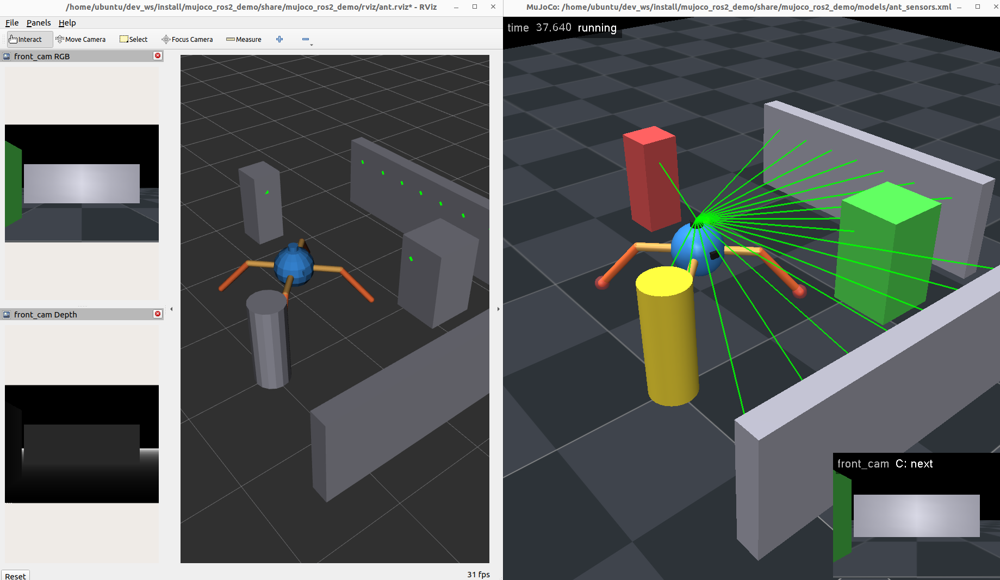

# mujoco_ros2_demo

MuJoCo simulation of robot models and sensors with ROS 2 components

## Dependencies

[![MuJoCo][mujoco-badge]][mujoco]
[![ROS 2][ros2-badge]][ros2]
[![Humble][humble-badge]][humble]
[![Ubuntu 22.04][ubuntu22-badge]][ubuntu22]

## Requirements

- ROS 2 (tested Ubuntu 22.04 Humble )
- MuJoCo **3.6.0** Python package (the C library and headers are taken from it)
  ```bash
  pip install mujoco==3.6.0
  ```
- GLFW
  ```bash
  sudo apt install libglfw3-dev
  ```

## Build

```bash
cd ~/dev_ws/src   # put mujoco_ros2_demo here
cd ~/dev_ws
colcon build --packages-select mujoco_ros2_demo
source install/setup.bash
```

No download is done at build time. The MuJoCo viewer (`simulate`) is bundled in `third_party/`.

## Run with ROS 2

Viewer + RViz:

```bash
ros2 launch mujoco_ros2_demo bringup.launch.py                      # ant
ros2 launch mujoco_ros2_demo bringup.launch.py model:=manipulator   # manipulator
```

Viewer only:

```bash
ros2 run mujoco_ros2_demo mujoco_viewer                                         # ant
ros2 run mujoco_ros2_demo mujoco_viewer --ros-args -p model_path:=manipulator_3dof.xml
```

Make the ant walk (in another terminal):

```bash
ros2 run mujoco_ros2_demo ant_walker
```

Move a joint from the command line:

```bash
ros2 topic pub --once /joint_commands sensor_msgs/msg/JointState "{name: [joint2], position: [0.8]}"
```

In the viewer: double-click a body to select it, Ctrl + right drag to push it, Ctrl + left drag to rotate it. Joints can also be moved with the Control sliders.




## Run with Python

Mujoco Viewer

```bash
python3 src/mujoco_ros2_demo/script/view.py  # manipulator
python3 src/mujoco_ros2_demo/script/view_ant.py  # ant
```

Mujoco Viewer + walk

```bash
python3 src/mujoco_ros2_demo/script/run_ant.py
```


## Topics (mujoco_viewer)

| topic                                   | type                           | note                                         |
|-----------------------------------------|--------------------------------|----------------------------------------------|
| `/joint_commands` (sub)                 | `sensor_msgs/JointState`       | `position` = target angle [rad]               |
| `/joint_states`                         | `sensor_msgs/JointState`       | position, velocity, effort                    |
| `/robot_description`                    | `std_msgs/String`              | URDF generated from the MJCF (transient local)|
| `/imu`                                  | `sensor_msgs/Imu`              | `imu_acc`, `imu_gyro`, `imu_quat` sensors     |
| `/scan`                                 | `sensor_msgs/LaserScan`        | rangefinders `lidar00` ... `lidar35`          |
| `/range_left`, `/range_right`           | `sensor_msgs/Range`            | other rangefinders                            |
| `/foot1_touch` ...                      | `std_msgs/Float32`             | touch sensors                                 |
| `/foot1_contact` ...                    | `geometry_msgs/WrenchStamped`  | contact force at the contact point            |
| `/<camera>/image_raw`, `/depth`         | `sensor_msgs/Image`            | rgb8, 32FC1 [m]                               |
| `/<camera>/camera_info`                 | `sensor_msgs/CameraInfo`       |                                              |
| `/<camera>/points`                      | `sensor_msgs/PointCloud2`      | xyz + rgb, also drawn in the viewer           |
| `/tf`                                   |                                | `world` -> every body, sensor frames          |

## Parameters (mujoco_viewer)

| name                        | default            | description                                       |
|-----------------------------|--------------------|---------------------------------------------------|
| `model_path`                | `ant_sensors.xml`  | file name in `models/` or absolute path           |
| `publish_rate`              | 100.0              | state publish rate [Hz]                           |
| `camera_names`              | `[]`               | cameras to publish (empty = all)                  |
| `camera_rate`               | 10.0               | camera / point cloud rate [Hz]                    |
| `camera_width`, `camera_height` | 640, 480       | image size (limited by `offwidth/offheight`)      |
| `pointcloud_stride`         | 4                  | use every n-th pixel                              |
| `pointcloud_in_viewer`      | true               | draw the point cloud in the viewer                |
| `shutdown_on_close`         | true               | shut down ROS when the viewer window is closed    |

`ant_walker`: `gait_freq`, `hip_amp_deg`, `ankle_lift_deg`, `stop_distance`, `rate`.

## Notes

- MuJoCo does not provide `simulate` as a library (pip / apt), so its sources (v3.6.0) are in `third_party/mujoco_simulate`. If your MuJoCo version is different, CMake prints a warning: replace that folder with the `simulate/` sources of your version.
- Buoyancy and other underwater forces are not part of this package.

## License
This repository is licensed under the MIT license, see LICENSE.

[humble-badge]: https://img.shields.io/badge/-HUMBLE-orange?style=flat-square&logo=ros
[humble]: https://docs.ros.org/en/humble/index.html

[ubuntu22-badge]: https://img.shields.io/badge/-UBUNTU%2022%2E04-blue?style=flat-square&logo=ubuntu&logoColor=white
[ubuntu22]: https://releases.ubuntu.com/jammy/

[mujoco-badge]: https://img.shields.io/badge/-MuJoCo-blueviolet?style=flat-square&logo=googlecolab&logoColor=white
[mujoco]: https://mujoco.org/

[ros2-badge]: https://img.shields.io/badge/-ROS%202-orange?style=flat-square&logo=ros&logoColor=white
[ros2]: https://docs.ros.org/en/humble/index.html